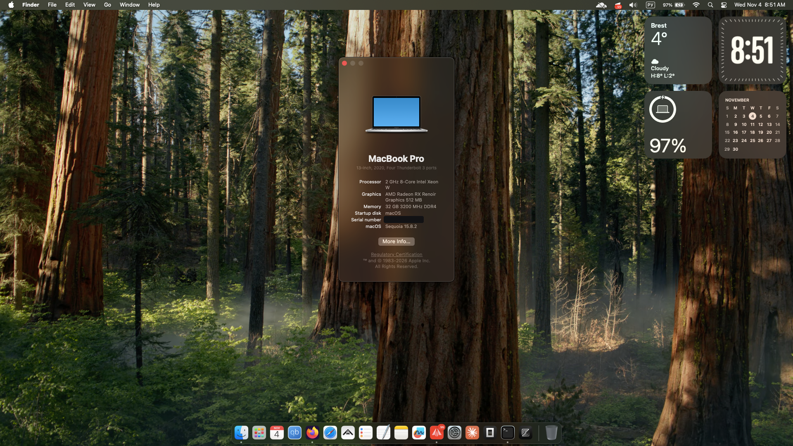

# HP Pavilion 15-eh3174nw Hackintosh (OpenCore EFI)

Working EFI folder for running macOS on **HP Pavilion 15-eh3174nw** (AMD Ryzen 7 7730U / Barcelo-R, Radeon Vega iGPU).

> ⚠️ **Read before first boot:** `config.plist` ships **without serial numbers on purpose**.
> Generate your own SMBIOS first — see [`docs/serial-generation-guide.md`](docs/serial-generation-guide.md).




> **macOS Sequoia 15.8.2 running on an actual HP Pavilion 15-eh3174nw.**

## Hardware

| Component | Detail |
|---|---|
| Laptop | HP Pavilion 15-eh3174nw |
| CPU | AMD Ryzen 7 7730U (8C/16T, Zen 3, base 2.0 GHz / boost 4.5 GHz) |
| iGPU | AMD Radeon Vega 7 (Barcelo `0x15e7`) — via **NootedRed** |
| Display | 15.6" 1920×1080 @60 Hz |
| RAM | 32 GB DDR4-3200 (2 × 16 GB) |
| Wi-Fi | Realtek RTL8852BE (802.11ac) — via **AirPort_RTW89** |
| Bluetooth | Realtek RTL8852BE (BT part) — **not working**, see below |
| Audio | Realtek onboard — via **AppleALC**, layout `alcid=21` |
| SSD | SAMSUNG MZVL41T0HBLB-00BH1 — 1 TB NVMe, TRIM: yes (via **NVMeFix**) |
| SMBIOS | `MacBookPro16,2` |

## Status: works / partial / broken

| Feature | Status | Notes |
|---|---|---|
| Boot / kernel | ✅ Works | Boots and runs fine |
| Wi-Fi (RTL8852BE) | ✅ Works | 2.4/5 GHz, 802.11ac, AirDrop shows as supported |
| Audio | ✅ Works | AppleALC, layout `21` (`alcid=21`) |
| Keyboard | ✅ Works | VoodooPS2Controller |
| Touchpad | ✅ Works | VoodooI2C + VoodooI2CHID |
| USB | ✅ Works | USBToolBox map (`UTBMap.kext`) |
| NVMe | ✅ Works | NVMeFix |
| Battery status | ✅ Works | ECEnabler + SMCBatteryManager |
| Brightness keys | ✅ Works | BrightnessKeys + SSDT-PNLF |
| Ambient light sensor | ✅ Works | Stub SSDT-ALS0 + SMCLightSensor |
| **CPU — Turbo Boost** | ⚠️ **Partial** | Runs at base **2.0 GHz only, no boost** (see [known issues](docs/known-issues.md)) |
| **Graphics** | ⚠️ **Partial** | Metal 3 works, but with glitches — see [known issues](docs/known-issues.md) |
| **Sleep / wake** | ❌ **Broken** | Sleep does not work — see [known issues](docs/known-issues.md) |
| **Bluetooth** | ❌ **Broken** | RTL8852BE BT part not initialized, see [known issues](docs/known-issues.md) |

Note: `About This Mac` shows fake values ("Intel Xeon W", "13-inch 2020") — that's the `MacBookPro16,2` SMBIOS spoof and intentional `ProcessorType` override, it is **harmless and expected** on an AMD hackintosh.

## Boot-args used

```
keepsyms=1 debug=0x100 watchdog=0 -NRedDPDelay alcid=21 alcverbs=1
```

* `-NRedDPDelay` — NootedRed: delays DP handshake (external display quirk)
* `alcid=21 alcverbs=1` — AppleALC layout for this sound card
* SIP is set to partial (`csr-active-config = 0x0B0B`) to allow NootedRed/Wifi legacy loading

## ACPI

| File | Purpose |
|---|---|
| `SSDT-EC-USBX.aml` | Fake EC device + USBX power properties |
| `SSDT-PNLF.aml` | Panel backlight device for NootedRed |
| `SSDT-ALS0.aml` | Ambient light sensor stub |
| `SSDT-PLUG-ALT.aml` | CPU plugin / HP (`8BC7`) MADT compatibility, CPU IDs 1–16 |

## Kexts

| Kext | Version | Purpose |
|---|---|---|
| Lilu | 1.7.2 | Patcher base (required) |
| VirtualSMC | 1.3.8 | SMC emulation |
| NootedRed | 0.8.10 | AMD Renoir/Barcelo iGPU driver |
| AppleALC | 1.9.8 | Audio |
| AirPort_RTW89 | 0.5.0 + IO80211FamilyLegacy + IOSkywalkFamily | Realtek Wi-Fi |
| BlueToolFixup | 2.7.2 | Bluetooth (currently not working) |
| RealtekBluetoothFirmware | 1.0.2 | BT firmware loader (currently not working) |
| AMFIPass | 1.4.1 | Kext signature enforcement relaxation |
| AppleMCEReporterDisabler | 1.2 | Prevents AppleMCEReporter panic on AMD |
| BrightnessKeys | 1.0.3 | Brightness hotkeys |
| ECEnabler | 1.0.6 | Full-size EC access (battery) |
| ForgedInvariant | 1.5.0 | AMD CPU invariant TSC workaround |
| NVMeFix | 1.1.3 | NVMe power/kernel fixes |
| SMCBatteryManager | 1.3.8 | Battery stats |
| SMCLightSensor | 1.3.8 | ALS |
| USBToolBox / UTBMap | 1.2.0 / 1.1 | USB port map |
| VoodooI2C / VoodooI2CHID | 2.9.1 | I2C touchpad |
| VoodooPS2Controller | 2.3.7 | PS2 emulation (keyboard) |

## Docs

* [`docs/serial-generation-guide.md`](docs/serial-generation-guide.md) — how to generate your own Serial / MLB / ROM / UUID and fill `config.plist`
* [`docs/known-issues.md`](docs/known-issues.md) — what is broken, why, and possible fixes

## Installation

1. Mount your EFI partition.
2. Replace its contents with this folder (`ACPI`, `Drivers`, `Kexts`, `Resources`, `Tools`, `OpenCore.efi`, `config.plist`).
3. **Generate and apply your own serials** (see the guide above) — do not skip this.
4. Reset NVRAM on the next boot.
5. Update OpenCore + kexts — always update all of them together.

## Credits

* [OpenCore](https://github.com/acidanthera/OpenCorePkg) — Acidanthera
* [Lilu](https://github.com/acidanthera/Lilu) & friends — Acidanthera & community
* [NootedRed](https://github.com/ChefKissArchives/NootedRed) — ChefKiss Archives (AMD iGPU support)
* `AirPort_RTW89` — see `Kexts/AirPort_RTW89.kext/Contents/Resources/CREDITS.md`
* [VoodooI2C](https://github.com/VoodooI2C/VoodooI2C) — Ben Miner et al.
* [USBToolBox](https://github.com/USBToolBox/kext) — USBToolBox
* [Dortania guides](https://dortania.github.io/) — documentation where most of this is learned from
